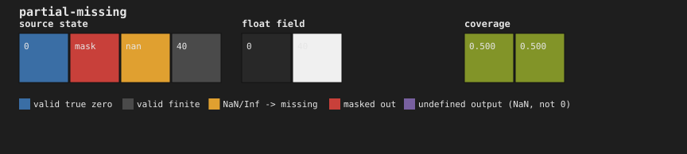
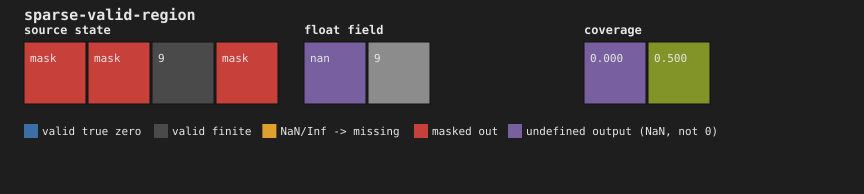
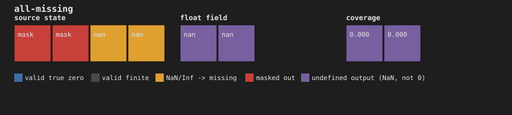

# Runnable validity-contract examples

Every image and table in this directory is produced by one command from one
shared scenario definition:

```bash
npm run contract:example    # node tools/contract/generate.js
```

The generator runs the production resampling kernel
(`src/core/resample.js`, the same entry the graphical page uses), checks the
validity contract, and writes the SVG, CSV and JSON of each scenario in the
same invocation. `manifest.json` records a SHA-256 hash of every artifact;
re-running on a clean checkout reproduces all files byte-for-byte. No-data
cells are written as the literal token `nan`, never as `0`.

The governing conventions live in
[../VALIDITY-CONTRACT.md](../VALIDITY-CONTRACT.md). Re-assert them with
`npm run contract:check`.

## partial-missing — local missing data

A true zero, a masked non-zero, a NaN inside the mask and a normal finite
pixel share one row. Both output cells are half covered; neither missing
sample may dilute a mean.



| cell | defined | intensity | coverage | valid weight | overlap sum |
|---|---|---|---|---|---|
| (0,0) | yes | 0 | 0.5 | 1 | 0 |
| (1,0) | yes | 40 | 0.5 | 1 | 40 |

Source pixels valid: 2/4 · true zeros: 1 · anomalies:
`NONFINITE_MARKED_VALID`, `NONZERO_MASKED_OUT`, `LOW_COVERAGE`.

## sparse-valid-region — sparse valid region next to an empty cell

Only one source pixel is usable. The left output cell has no usable overlap
and is `NaN` with coverage 0; the right cell keeps the one usable value.



| cell | defined | intensity | coverage | valid weight | overlap sum |
|---|---|---|---|---|---|
| (0,0) | no | nan | 0 | 0 | 0 |
| (1,0) | yes | 9 | 0.5 | 1 | 9 |

Source pixels valid: 1/4 · undefined cells: 1 · anomalies:
`NONZERO_MASKED_OUT`, `UNDEFINED_OUTPUT_CELLS`, `LOW_COVERAGE`.

## all-missing — no usable data anywhere

Two pixels are masked out and two hold NaN inside the mask. Every output
cell is `NaN`; the valid means are reported as `NaN` (and min/max as
`null`), not as zero defaults.



| cell | defined | intensity | coverage | valid weight | overlap sum |
|---|---|---|---|---|---|
| (0,0) | no | nan | 0 | 0 | 0 |
| (1,0) | no | nan | 0 | 0 | 0 |

Source pixels valid: 0/4 · undefined cells: 2 · anomalies:
`NO_VALID_SAMPLES`, `NONFINITE_MARKED_VALID`, `UNDEFINED_OUTPUT_CELLS`.

## Files

| File | Content |
|---|---|
| `scenario-*.svg` | source state, float field and coverage panels from the run |
| `scenario-*.csv` | full-precision per-cell table of the same run |
| `scenario-*.json` | per-cell values, stats and anomaly codes |
| `manifest.json` | SHA-256 of every artifact, tying image and table to one run |
